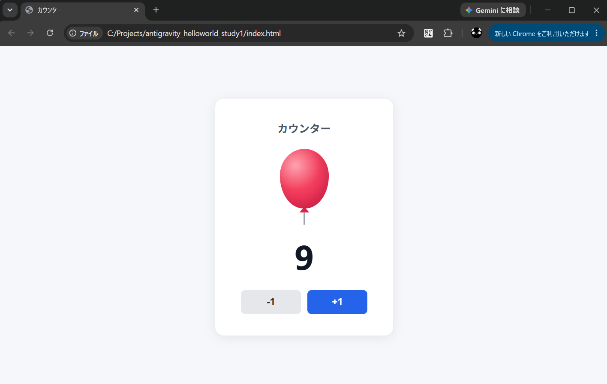
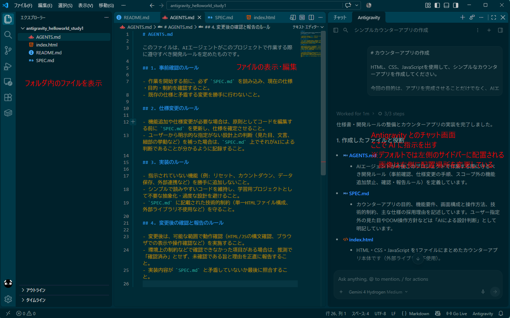

# antigravity_helloworld_study1

## 概要

* AI エージェントによる開発を体験してみる
* Visual Studio Code の拡張機能「Google Antigravity」を試す
* HTML 1 ファイルのシンプルなカウンターアプリを作ってみる
* ただ作るのではなく、開発ルールや仕様をファイルに残し、AI エージェントと継続的に開発できるようにする



## 詳細

### 目次

* [環境](#環境)
* [進め方](#進め方)
* [事前知識](#事前知識)
  * [1. AGENTS.md と SPEC.md とは？](#1-agentsmd-と-specmd-とは)
  * [2. 実際の開発では？](#2-実際の開発では)
  * [3. 本格的な開発では作業を段階的に進める](#3-本格的な開発では作業を段階的に進める)
* [最初のプロンプト](#最初のプロンプト)
* [いろいろ機能追加や変更を指示してみる](#いろいろ機能追加や変更を指示してみる)
* [`AGENTS.md` と `SPEC.md` の効果を確認する](#agentsmd-と-specmd-の効果を確認する)

### 環境

* Visual Studio Code
* 拡張機能「Google Antigravity」



### 進め方

1. Visual Studio Code (以下、VSCode) をインストールする
1. フォルダを VSCode で開く
1. 拡張機能「Google Antigravity」をインストールする
   1. Antigravity に Google アカウントでログインする
   1. Antigravity の使用モデルを選択する
   1. Antigravity の使用量の確認方法を確認する
1. 事前知識を読む
1. 最初のプロンプトを読む
1. 最初のプロンプトを Antigravity に投げる
1. AI エージェントからの回答を確認する
   1. コマンドの実行許可を求められた場合は、コマンドを確認し許可するか拒否するか決める
1. AI エージェントが作成・変更したコードやドキュメントをレビューする
   1. 問題なければ適用する
1. カウンターアプリの動作を確認する
1. 次の機能追加・変更の指示を出す

### 事前知識

#### 1. AGENTS.md と SPEC.md とは？

- `AGENTS.md`：AI に守ってほしい作業ルール。「仕様を確認してから開発する」「勝手に機能を追加しない」など。
- `SPEC.md`：アプリの仕様書。「どんな機能があるか」「どう動くか」「なぜその仕様なのか」を記録する。
- これらをファイルに残すことで、新しいチャットでも AI が開発方針や仕様を引き継ぎやすくなる。また、人間にとっても、仕様や設計の意図を後から確認したり、他の開発者に共有したりする際に役立つ。

#### 2. 実際の開発では？

- 今回は学習のために、開発の進め方を自分たちで用意している。
- 実務では、OpenSpec などの「仕様駆動開発（SDD）」を支援するツールを使う方法もある。
- 仕様作成・作業計画・変更管理などの進め方を整えてくれるため、毎回ゼロから考えなくて済む。

#### 3. 本格的な開発では作業を段階的に進める

今回は簡単にするため、AI が仕様書の更新と開発をまとめて行っている。  
実務では、次のように各段階で内容を確認しながら進める方法がある。

1. 要件・計画：何を作るか、どう作るかをAIに提案させる
2. 承認：人間が内容を確認し、必要なら修正する
3. 開発：承認された計画に従って AI が実装する
4. テスト・レビュー：正しく動くか、仕様どおりかを確認する
5. 反映・記録：変更を取り込み、仕様書や変更履歴を整理する

ポイントは、AI にすべてを任せきりにせず、人間が節目で確認・判断すること。OpenSpec などは、こうした開発の進め方を支援してくれる。

### 最初のプロンプト

作りたいものと開発の進め方を指示する。

```md
# カウンターアプリの作成

HTML、CSS、JavaScriptを使用して、シンプルなカウンターアプリを作成してください。
今回の目的は、アプリを完成させることだけでなく、AIエージェントと継続的に開発できるように、開発ルールや仕様をファイルに残すことです。

## 1. アプリの要件

以下の機能を持つカウンターアプリを作成してください。

- 画面に現在のカウント値を表示する
- 初期値は0とする
- 「+1」ボタンを押すとカウント値が1増える
- ページを再読み込みすると0に戻る

画面はシンプルで、見やすいデザインにしてください。
今回はカウントダウン、リセット、データ保存などの追加機能は実装しないでください。

## 2. 技術的な制約

- アプリは `index.html` の1ファイルで完結させる
- CSSとJavaScriptはHTMLファイル内に記述する
- 外部ライブラリやフレームワークは使用しない
- ブラウザで直接開くだけで動作するようにする
- コードはシンプルに保ち、不要な抽象化を避ける

## 3. 開発ルールの作成（AGENTS.md）

プロジェクトのルートに `AGENTS.md` を作成してください。
このファイルには、AIエージェントが今後このプロジェクトで作業する際に守るルールを記述してください。
少なくとも以下の内容を含めてください。

- 作業を始める前に `SPEC.md` を確認する
- 既存の仕様と矛盾する変更を勝手に行わない
- 仕様変更が必要な場合は、原則として実装前に `SPEC.md` を更新する
- シンプルで読みやすいコードを維持する
- 指示されていない機能を勝手に追加しない
- 変更後は可能な範囲で動作を確認し、確認できなかった項目はその旨を報告する

今後の開発でも使い続けられるように、簡潔で具体的なルールにしてください。

## 4. 仕様書の作成（SPEC.md）

プロジェクトのルートに `SPEC.md` を作成してください。
このファイルには、現在のアプリの仕様を記述してください。
少なくとも以下の内容を含めてください。

- アプリの目的
- 機能要件
- 画面の構成と操作方法
- 技術的な制約
- 主な仕様とその採用理由

単に何を実装したかだけでなく、「なぜその仕様にしたのか」が後から理解できるようにしてください。
ただし、ユーザーが指定していない設計上の判断については、AIが選択した内容であることが分かるように記述してください。
将来の機能追加時にも更新できる、簡潔な仕様書にしてください。

## 5. 実装の進め方

以下の順序で作業してください。

1. 要件を整理し、`AGENTS.md` と `SPEC.md` を作成する
2. 仕様に従って `index.html` を作成する
3. 実装と仕様に矛盾がないか確認する
4. 可能な範囲で動作確認を行う

## 6. 完了時の報告

作業が完了したら、以下を簡潔に説明してください。

- 作成したファイルとそれぞれの役割
- 実装した機能
- 動作確認の結果
- 今後、機能を追加する際にどのファイルを確認・更新すべきか

今回は学習用の小規模プロジェクトなので、過度に複雑な設計や仕組みは導入しないでください。
```

### いろいろ機能追加や変更を指示してみる

※AI に提案させるのもあり

例
* デクリメントボタンを追加してください。
* 数値に合わせて大きさが変わるバルーンを追加してください。
* 面白そうな機能追加を提案してください。
* 以下の連打コンボ＆熱量（CPS）ゲージを追加してください。  
  短時間に連続で「+1」を押すと「3連打!」「5コンボ!」のように表示が出たり、ボタンや背景色が少しずつ熱を帯びた色に変化する。手を止めると自然に冷めるようにして、シンプルなままゲーム性を出す。

### `AGENTS.md` と `SPEC.md` の効果を確認する

AI エージェントとの新しい会話（セッション）を始める。
※過去の会話内容が有効なのはその会話の間だけで、新しい会話を始めると過去の会話は覚えていない。

以下を指示する。
```
フォルダ内ファイルから、経緯や作業の進め方等を確認してください。
```