# 拡張機能「Google Antigravity」のインストール方法など

## 目次

## 拡張機能「Google Antigravity」のインストール

* 左側サイドバーの拡張機能をクリック
* `antigravity` で検索
* `Google Antigracity` をインストール

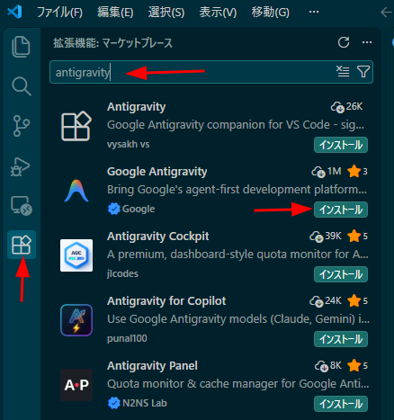

* 左側サイドバーに `Antigracity` が追加されるのでクリック
* Google アカウントでログイン

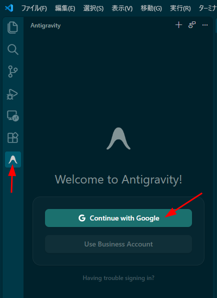

* 外部の Web サイトを開くか聞かれるので、開くをクリック

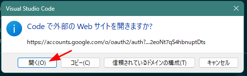

* ブラウザで Google でログインページが表示されるので、`Antigracity` で利用したいアカウントでログイン
* `Google Antigracity` の認証が完了しました。と表示されれば OK
* Visual Studio Code を開きますか？のメッセージはキャンセルで閉じる
* 認証が完了しましたページも閉じて OK

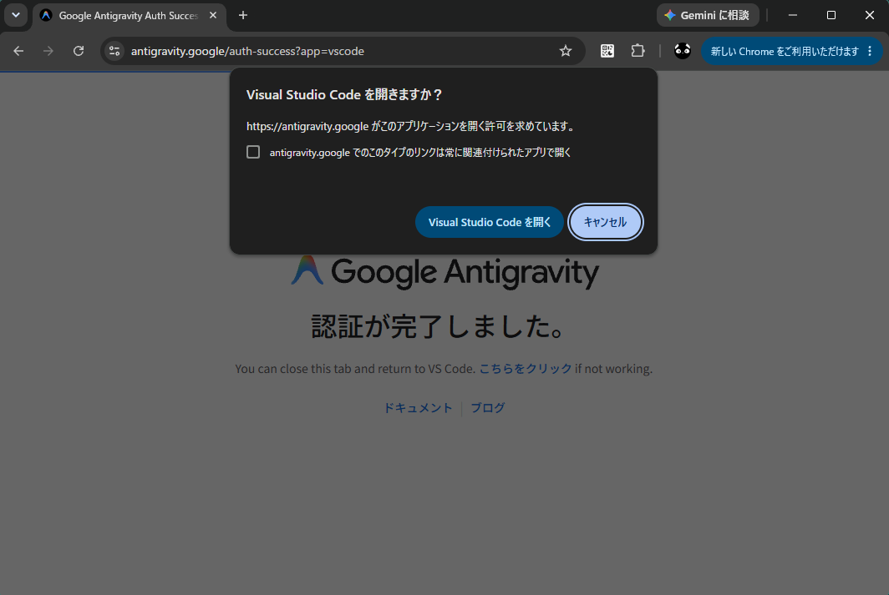

* VSCode の画面に戻ると以下の確認メッセージが表示される  
  （日本語訳は後述）

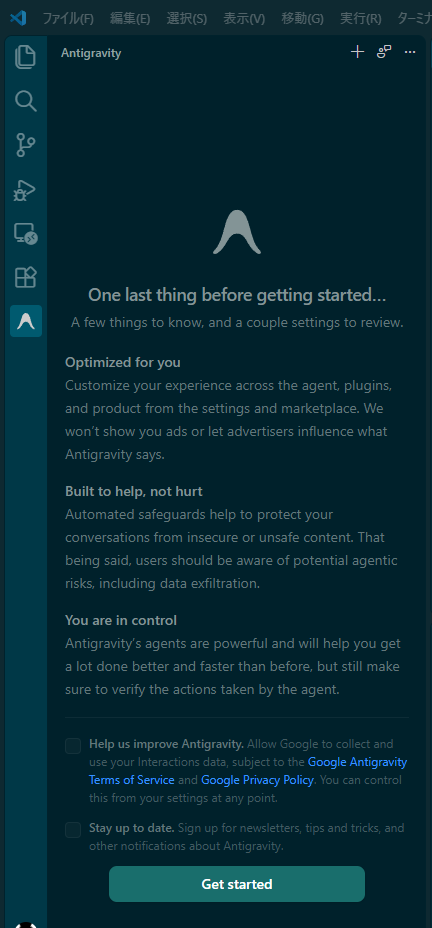

* 日本語訳は以下のとおり  

  ### 始める前に最後にもう一つ...  
  知っておくべきいくつかの点と、確認しておく設定項目です。

  #### あなたに合わせて最適化
  設定やマーケットプレイスから、エージェント、プラグイン、製品全体の利用体験をカスタマイズできます。広告を表示したり、広告主がAntigravityの応答内容に影響を与えたりすることはありません。

  #### 害を与えるのではなく、助けるための設計
  自動保護機能により、安全でないコンテンツや危険なコンテンツから会話を守ります。ただし、データの不正持ち出し（データ流出）を含む、エージェント機能に伴う潜在的なリスクには注意してください。

  #### 主導権はあなたにあります
  Antigravityのエージェントは強力で、これまで以上に多くの作業をより良く、より速くこなす手助けをしますが、エージェントが実行した操作は必ずご自身で確認してください。

  ---

  ☐ Antigravityの改善に協力する。Google Antigravity利用規約およびGoogleプライバシーポリシーに従い、Googleがユーザーのインタラクション（やり取り）データを収集・使用することを許可します。この設定はいつでも設定画面から変更できます。

  ☐ 最新情報を受け取る。Antigravityに関するニュースレター、活用のヒント、その他のお知らせに登録します。

  [ 始める ]

* 全文よく読んで `Get started` をクリック  
  ※チェックは任意だが、よくわからない場合はチェックしない。

* 以下の画面になれば完了  
  ※たまにチャット欄の上に新機能や新モデルを紹介するポップアップが表示される場合がある。その場合はポップアップ左下の `dismiss` をクリックして閉じる。

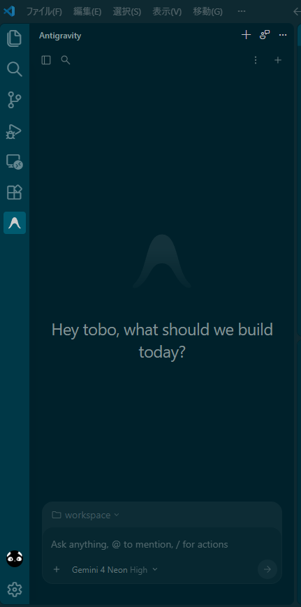

## モデルと思考量の選択

* チャット欄の下に表示されている現在のモデルをクリック
* 使用したいモデルと思考量を選択
* 現在のモデルが選択したものに変われば OK

※モデルと思考量によって使用量（クォータ消費）が変わる。  
AI エージェントの利用には使用上限が設定されている。（週毎の上限と5時間毎の上限）  
賢いモデルを深く考えさせるほど、回答の精度は上がるが使用量（クォータ消費）も大きくなり使用上限に早く到達してしまう。  

任せる仕事によってモデルや思考量を適切に選択すべきだが、よくわからない場合はとりあえず、学習やお試しでは「Gemini 4 Hydrogen Medium」、本番では「Gemini 4 Neon High」でよい。

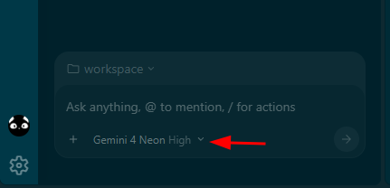

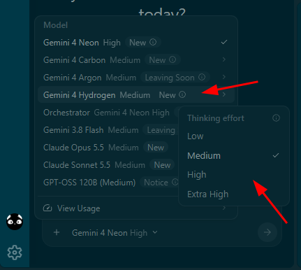

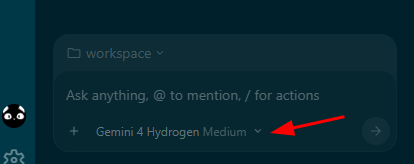

## 現在の使用量（クォータ消費）の確認

* チャット欄の下に表示されている現在のモデルをクリック
* View Usage をクリック

※AI エージェントの利用には使用上限が設定されている。（週毎の上限と5時間毎の上限）  
Gemini 系のモデルと、Claude と GPT 系のモデルで使用上限は別々に設定されている。

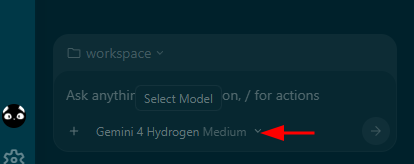

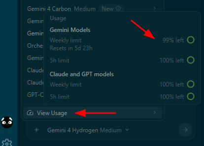

## チャット欄の表示位置を変更

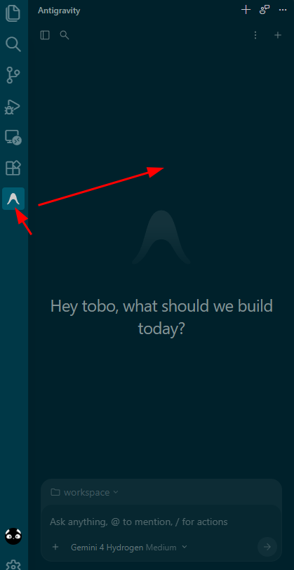

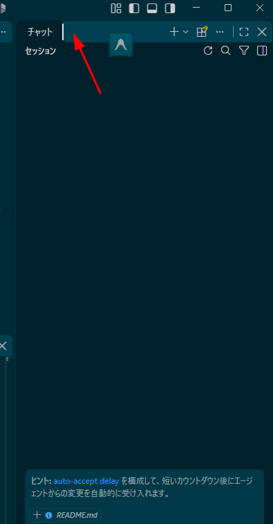

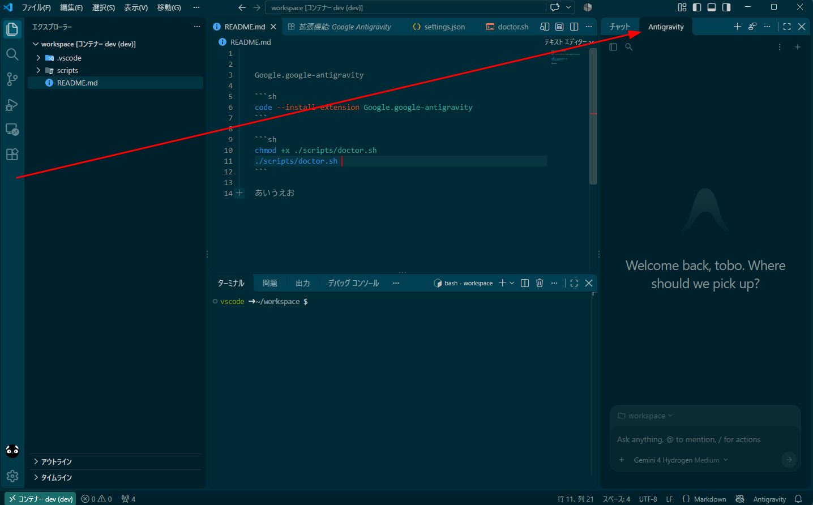